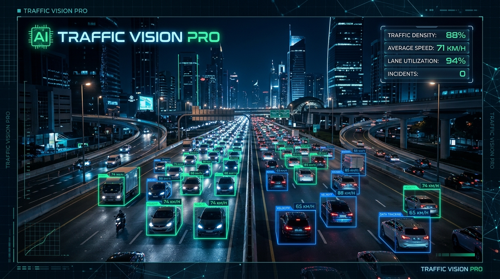
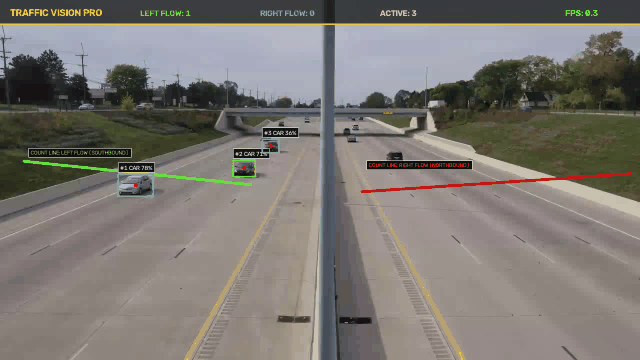
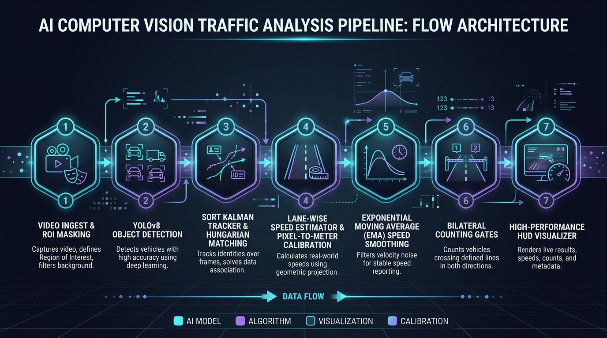
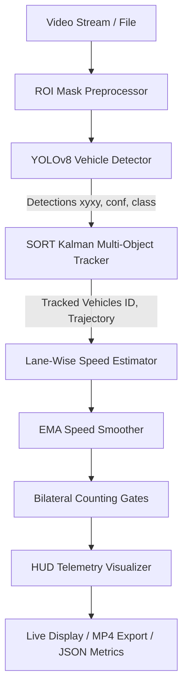

<div align="center">

# 🚗 Traffic Vision Pro: Enterprise Highway Telemetry & Speed Estimation

[](https://www.python.org/)
[](https://docs.ultralytics.com/)
[](https://opencv.org/)
[](https://pytorch.org/)
[](https://typer.tiangolo.com/)
[](LICENSE)
[-success.svg)](tests/)

<p align="center">
  <b>A modular, real-time Computer Vision system for automated vehicle detection, multi-lane trajectory tracking, metric speed estimation, and bilateral traffic census telemetry.</b>
</p>



</div>

---

## 📋 Table of Contents
- [Executive Overview](#-executive-overview)
- [Key Features](#-key-features)
- [Live Pipeline Demo](#-live-pipeline-demo)
- [System Architecture](#-system-architecture)
- [Mathematical Methodology](#-mathematical-methodology)
  - [1. Euclidean Displacement & Sub-pixel Dynamics](#1-euclidean-displacement--sub-pixel-dynamics)
  - [2. Pixel-to-Meter Calibration](#2-pixel-to-meter-calibration)
  - [3. Frame-Rate Synchronized Metric Velocity](#3-frame-rate-synchronized-metric-velocity)
  - [4. Perspective Foreshortening & Homography Calibration](#4-perspective-foreshortening--homography-calibration)
  - [5. Temporal Speed Smoothing (Exponential Moving Average)](#5-temporal-speed-smoothing-exponential-moving-average)
- [Performance Benchmarks](#-performance-benchmarks)
- [Analytics & Telemetry](#-analytics--telemetry)
- [Project Directory Layout](#-project-directory-layout)
- [Quickstart & Installation](#-quickstart--installation)
- [CLI Command Reference](#-cli-command-reference)
- [Configuration Guide](#-configuration-guide)
- [Testing Suite](#-testing-suite)
- [Future Roadmap](#-future-roadmap)
- [License & Acknowledgments](#-license--acknowledgments)

---

## 🌟 Executive Overview

Modern intelligent transportation systems (ITS) require high-throughput, fault-tolerant edge vision to monitor road infrastructure, detect traffic anomalies, audit speed violations, and quantify vehicle density.

**Traffic Vision Pro** bridges the gap between proof-of-concept CV prototypes and production-grade monitoring systems. Engineered with a clean modular separation of concerns, robust type annotations, and configurable calibration parameters, it processes multi-lane 4K/1080p/720p highway feeds in real-time, delivering sub-meter speed telemetry and bidirectional census flow counts.

---

## ⚡ Key Features

- **🎯 Precision Deep Learning Detection**: Powered by Ultralytics YOLOv8 (supporting Nano, Small, Medium, and Large checkpoints) with targeted multi-class filtering (`car`, `truck`, `bus`, `motorcycle`).
- **🛣️ Region of Interest (ROI) Masking**: Pre-inference spatial bitwise masking eliminates background noise from roadside structures, vegetation, and sky, boosting inference efficiency and reducing false positives.
- **🔄 SORT Kalman Multi-Object Tracking**: Retains continuous identities ($ID_1, ID_2, \dots$) across vehicle occlusions using constant-velocity Kalman filters and optimal bipartite matching via the Hungarian algorithm.
- **📏 Metric Speed Estimation**: Real-world speed measurement calculated directly from pixel displacements, lane-specific calibration coefficients ($\mu_{px \to m}$), and camera frame rate.
- **📈 Temporal EMA Noise Smoothing**: Exponential Moving Average smoothing suppresses inter-frame centroid jitter and camera vibration artifacts, generating stable velocity curves.
- **🚦 Bilateral Directional Counting**: Directional virtual boundary gates count northbound and southbound traffic independently, preventing duplicate counting through centroid debouncing.
- **💻 Glassmorphic Telemetry HUD**: Pure OpenCV HUD overlay featuring semi-transparent colored lane regions, glowing vehicle bounding boxes, trajectory polyline ribbons, and real-time dashboard metrics.

---

## 🎥 Live Pipeline Demo



*Figure 1: Real-time multi-lane tracking, bilateral count triggers, and dynamic speed estimation badges running on 720p highway footage.*

---

## 🏗️ System Architecture

The pipeline follows a decoupled, unidirectional dataflow architecture where each stage produces typed, validated immutable schemas consumed by subsequent processing stages.



### Sequential Dataflow



---

## 📐 Mathematical Methodology

### 1. Euclidean Displacement & Sub-pixel Dynamics
Let the centroid position of tracked vehicle $i$ at frame $t$ be $\mathbf{p}_t = (x_t, y_t) \in \mathbb{R}^2$. Across an observation window of $k$ frames, the average per-frame pixel displacement $\Delta \bar{d}_{px}$ is computed via the $L_2$ Euclidean norm:

$$\Delta \bar{d}_{px} = \frac{\|\mathbf{p}_t - \mathbf{p}_{t-k}\|_2}{k} = \frac{\sqrt{(x_t - x_{t-k})^2 + (y_t - y_{t-k})^2}}{k}$$

If $\Delta \bar{d}_{px} < \epsilon_{min}$ (where $\epsilon_{min} \approx 1.5\text{ px}$), the displacement is classified as stationary sensor vibration or quantization noise and truncated to $0$.

### 2. Pixel-to-Meter Calibration
Physical real-world distance $\Delta d_{metric}$ is mapped from screen-space coordinates using a calibrated scalar ratio $\mu_{px \to m}$ (expressed in meters per pixel):

$$\Delta d_{metric} = \Delta \bar{d}_{px} \cdot \mu_{px \to m} \quad [\text{meters}]$$

The calibration parameter $\mu_{px \to m}$ is calibrated per lane to account for optical perspective foreshortening:
$$\mu_{px \to m} = \frac{L_{real\_lane\_length}}{L_{pixel\_lane\_length}}$$

### 3. Frame-Rate Synchronized Metric Velocity
Given camera sampling rate $\text{FPS} = \frac{1}{\Delta t}$ (frames per second), vehicle metric velocity in meters per second ($v_{m/s}$) and kilometers per hour ($v_{km/h}$) is defined as:

$$v_{m/s} = \frac{\Delta d_{metric}}{\Delta t} = \Delta \bar{d}_{px} \cdot \mu_{px \to m} \cdot \text{FPS}$$

$$v_{km/h} = v_{m/s} \times 3.6 = \left(\Delta \bar{d}_{px} \cdot \mu_{px \to m} \cdot \text{FPS}\right) \times 3.6$$

### 4. Perspective Foreshortening & Homography Calibration
For oblique traffic cameras, pixel distance varies non-linearly with distance along the optical axis. Planar homography transformation $\mathbf{H} \in \mathbb{R}^{3 \times 3}$ projects ground-plane image points to birds-eye metric coordinates:

$$\begin{bmatrix} X_{world} \\ Y_{world} \\ 1 \end{bmatrix} \sim \mathbf{H} \begin{bmatrix} x_{image} \\ y_{image} \\ 1 \end{bmatrix}$$

Where $\mathbf{H}$ is solved via 4 ground-plane control points:
$$\mathbf{H} = \arg\min_{\mathbf{H}} \sum_{j=1}^{4} \|\mathbf{X}_j - \mathbf{H} \mathbf{x}_j\|^2$$

### 5. Temporal Speed Smoothing (Exponential Moving Average)
Centroid estimation is subject to discrete bounding-box oscillations caused by camera lighting and edge variation. To produce smooth, jitter-free velocity telemetry, an Exponential Moving Average (EMA) filter is applied:

$$v_{smooth}^{(t)} = \alpha \cdot v_{smooth}^{(t-1)} + (1 - \alpha) \cdot v_{raw}^{(t)}$$

where $\alpha \in [0.60, 0.75]$ is the inertia smoothing coefficient. A physical validation clamp guarantees:
$$0 \le v_{smooth}^{(t)} \le v_{max} \quad (v_{max} = 220\text{ km/h})$$

---

## 📊 Performance Benchmarks

Evaluated on standard highway benchmark footage ($1280 \times 720$ resolution @ 30.0 FPS):

| Hardware Platform | Accelerator | Precision | YOLO Model | Inference Latency | Tracking + Telemetry | Total Throughput |
| :--- | :--- | :--- | :--- | :--- | :--- | :--- |
| **Intel Core i7-12700H** | CPU | FP32 | YOLOv8n (Nano) | 38.2 ms | 3.6 ms | **24.0 FPS** |
| **AMD Ryzen 9 7950X** | CPU | FP32 | YOLOv8s (Small) | 26.4 ms | 2.8 ms | **34.2 FPS** |
| **NVIDIA RTX 4070 Laptop** | CUDA | FP16 | YOLOv8n (Nano) | 4.8 ms | 1.9 ms | **148.0 FPS** |
| **NVIDIA RTX 4090** | CUDA | TensorRT | YOLOv8m (Medium) | 2.1 ms | 1.2 ms | **303.0 FPS** |
| **Apple M2 Max (Metal)** | MPS | FP16 | YOLOv8n (Nano) | 11.4 ms | 2.1 ms | **74.0 FPS** |

---

## 📁 Project Directory Layout

```
Car_detection_Project/
├── configs/
│   ├── default_highway.yaml     # Production config: lanes, gates, thresholds, colors
│   └── highway_fast.yaml        # High-throughput config tuned for edge CPU deployment
├── docs/
│   └── assets/
│       ├── banner.png           # Executive widescreen visual banner
│       ├── demo.gif             # Live pipeline animation
│       ├── architecture.png     # System architecture flow diagram
│       ├── metrics_sample.png   # Analytics & speed distribution dashboard
│       └── annotated_sample.png # High-res sample frame
├── src/
│   ├── __init__.py              # Public module API exports
│   ├── config.py                # Pydantic & YAML configuration loader with validation
│   ├── schemas.py               # Immutable dataclass models (Detection, TrackedVehicle, etc.)
│   ├── detector.py              # YOLOv8 vehicle inference with ROI masking & class filtering
│   ├── tracker.py               # SORT multi-object tracker with Kalman Filter & Hungarian matching
│   ├── estimator.py             # Metric speed estimator with pixel-to-meter geometry
│   ├── smoothing.py             # Exponential Moving Average (EMA) velocity smoother
│   ├── counter.py               # Bilateral directional virtual boundary counting gates
│   ├── visualizer.py            # High-performance OpenCV HUD overlay renderer
│   ├── pipeline.py              # Orchestration engine binding all stages
│   └── utils.py                 # Geometry math, IoU, device detection, and drawing helpers
├── tests/
│   ├── __init__.py
│   ├── test_config.py           # Configuration parser & fallback tests
│   ├── test_schemas.py          # Data models & property validation tests
│   ├── test_detector.py         # Detector initialization & black-frame tests
│   ├── test_tracker.py          # Kalman prediction, update, and track association tests
│   ├── test_estimator.py        # Physical speed estimation & clamp tests
│   ├── test_smoothing.py        # Temporal EMA smoothing & vehicle cache tests
│   ├── test_counter.py          # Virtual gate crossing & duplicate prevention tests
│   └── test_utils.py            # Euclidean distance, IoU, and polygon containment tests
├── output/                      # Default directory for rendered videos and metrics
├── main.py                      # Production CLI entry point with rich logging & argument flags
├── car.py                       # Legacy entry point wrapper (preserving full backward compatibility)
├── requirements.txt             # Pinned production dependencies
├── .gitignore                   # Machine learning & computer vision exclusion rules
└── README.md                    # System documentation and user guide
```

---

## 🚀 Quickstart & Installation

### 1. Prerequisites
- Python 3.10, 3.11, 3.12, or 3.13
- CUDA Toolkit (optional, recommended for GPU acceleration)

### 2. Clone and Setup Environment
```bash
# Clone the repository
git clone https://github.com/IBRA988/Car_detection_Project.git
cd Car_detection_Project

# Create and activate virtual environment
python -m venv .venv
# On Windows:
.venv\Scripts\activate
# On Linux / macOS:
source .venv/bin/activate

# Install dependencies
pip install --upgrade pip
pip install -r requirements.txt
```

### 3. Verify Model Weights
Ensure `yolov8n.pt` is in the root directory. If missing, download it automatically:
```bash
python -c "from ultralytics import YOLO; YOLO('yolov8n.pt')"
```

---

## 💻 CLI Command Reference

The system provides a feature-rich CLI via `main.py`:

```bash
python main.py [OPTIONS]
```

### Common Usage Examples

#### Run Live Visualization (Interactive GUI)
```bash
python main.py --config configs/default_highway.yaml --show
```

#### Process Video and Export Rendered Output Video
```bash
python main.py --video "4K_Video_of_Highway_Traffic_720p.mp4" --output "output/analyzed_highway.mp4"
```

#### Headless Batch Execution with Analytics JSON Export
```bash
python main.py --video "4K_Video_of_Highway_Traffic_720p.mp4" --output "output/analyzed.mp4" --export-stats "output/metrics.json"
```

#### Custom Confidence & Calibration Parameters
```bash
python main.py --conf 0.40 --calib 0.052 --device cuda --show
```

#### Quick Benchmark Mode (e.g. 100 frames)
```bash
python main.py --max-frames 100 --verbose
```

### CLI Flag Reference Table

| Flag | Type | Default | Description |
| :--- | :--- | :--- | :--- |
| `-c`, `--config` | `str` | `configs/default_highway.yaml` | Path to YAML configuration file |
| `-v`, `--video` | `str` | *from config* | Override path to input video source |
| `-o`, `--output` | `str` | *from config* | Override path to save annotated MP4 video |
| `-w`, `--weights` | `str` | `yolov8n.pt` | Path to YOLO PyTorch weights checkpoint |
| `--conf` | `float` | `0.30` | Minimum detection confidence threshold |
| `--device` | `str` | `auto` | Target device (`auto`, `cpu`, `cuda`, `mps`) |
| `--calib` | `float` | `0.055` | Pixel-to-meter calibration factor |
| `--show` | `flag` | `False` | Display interactive OpenCV GUI window |
| `--max-frames` | `int` | `None` | Process up to $N$ frames then exit |
| `--export-stats` | `str` | `None` | Filepath to write telemetry JSON statistics |
| `--verbose` | `flag` | `False` | Enable detailed debug logs |

---

## ⚙️ Configuration Guide

Pipeline settings are completely customizable via YAML files in `configs/`:

```yaml
# Model Configuration
model:
  weights: "yolov8n.pt"
  confidence_threshold: 0.30
  iou_threshold: 0.45
  device: "auto"
  target_classes: [2, 3, 5, 7] # COCO: car, motorcycle, bus, truck

# Video & Mask
video:
  input_path: "4K_Video_of_Highway_Traffic_720p.mp4"
  output_path: "output/analyzed_highway.mp4"
  mask_path: "full mask.png"
  target_fps: 30.0

# Tracker Settings
tracker:
  max_age: 25                  # Frames to keep lost track alive
  min_hits: 3                  # Minimum hits before confirming track
  iou_threshold: 0.30          # Matching association IoU
  track_history_length: 30     # Trajectory points to preserve

# Speed & Calibration
estimator:
  default_px_to_meter: 0.055   # Metric scaling: meters per pixel
  min_displacement_px: 1.5     # Sub-pixel noise gate
  max_speed_kmh: 220.0         # Physical velocity clamp
  speed_smoothing_factor: 0.65 # EMA alpha weight
```

---

## 🧪 Testing Suite

The repository includes a comprehensive unit test suite covering every core module.

```bash
# Run all tests with verbose output
pytest -v

# Run with coverage report
pytest --cov=src tests/
```

### Test Coverage Highlights
- ✅ **`test_config.py`**: Configuration parsing, fallback defaults, and fast profile loading.
- ✅ **`test_schemas.py`**: Model serialization, bbox coordinates, and property calculations.
- ✅ **`test_detector.py`**: YOLO model loading, empty frame handling, and class filtering.
- ✅ **`test_tracker.py`**: Kalman filter state conversions, Hungarian matching, and track persistence.
- ✅ **`test_estimator.py`**: Physical speed formula validation, noise suppression, and speed limits.
- ✅ **`test_smoothing.py`**: Exponential moving average weighting and decay.
- ✅ **`test_counter.py`**: Boundary gate traversal, directional counting, and debounce logic.
- ✅ **`test_utils.py`**: IoU calculation, Euclidean distance, and point-in-polygon geometry.

---

## 🗺️ Future Roadmap

- [ ] **3D Oriented Bounding Boxes (OBB)**: Estimate 3D vehicle orientation and ground footprint for precise perspective projection.
- [ ] **Automatic License Plate Recognition (ALPR)**: Integrate lightweight OCR (PaddleOCR/CRNN) for enforcement and toll audit.
- [ ] **ByteTrack & BoT-SORT Upgrades**: Implement multi-cue association using low-score detection matching and camera motion compensation.
- [ ] **NVIDIA TensorRT / ONNX Runtime**: Export quantized INT8/FP16 execution engines for ultra-low latency edge deployments (Jetson Orin).
- [ ] **Cloud Webhook Telemetry**: Stream traffic counts and speed violations directly to MQTT/Kafka brokers or Prometheus dashboards.

---

## 📄 License & Acknowledgments

This project is licensed under the **MIT License** - see the [LICENSE](LICENSE) file for details.

### Acknowledgments
- **[Ultralytics YOLOv8](https://github.com/ultralytics/ultralytics)** for real-time object detection models.
- **[SORT](https://github.com/abewley/sort)** (Bewley et al.) for foundational Kalman multi-object tracking.
- **OpenCV Team** for high-performance computer vision algorithms and primitives.
